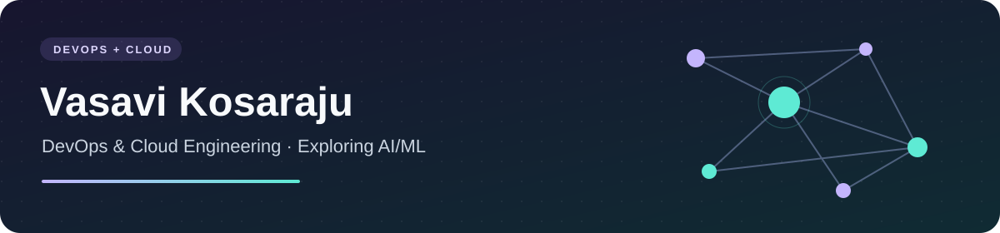

# Hi there, I’m Vasavi 👋

### DevOps & Cloud Engineering · Exploring AI/ML

- ☁️ My current focus is **DevOps, cloud infrastructure, and automation**.
- 🛠️ I’m building portfolio tools for **deployment checks, reliability, and cloud operations**.
- 🌱 I’m interested in **AI/ML**, especially information retrieval, evaluation, and reliable AI systems.
- 🔎 Explore my projects below for working examples, tests, and design notes.
- 💬 Let’s connect about **DevOps, Cloud, and practical AI projects**.

## Connect with me

## Languages and tools

**Cloud:** Azure · AWS  
**Delivery & infrastructure:** Terraform · Azure Bicep · Azure DevOps · GitHub Actions · Jenkins  
**Containers & scripting:** Docker · Kubernetes · Python · Bash · PowerShell

## Featured DevOps & Cloud projects

| Project | What it does |
| --- | --- |
| [🚦 Release Preflight](https://github.com/VasaviKosaraju1/release-preflight) | Checks Kubernetes deployment configuration before a release |
| [📈 SLO Report](https://github.com/VasaviKosaraju1/slo-report) | Reports availability, latency, and request-based error budgets |
| [🔐 Artifact Integrity](https://github.com/VasaviKosaraju1/artifact-integrity) | Detects changed, missing, or unexpected release files using SHA-256 manifests |
| [☁️ Cloud Budget Planner](https://github.com/VasaviKosaraju1/cloud-budget-planner) | Estimates infrastructure scenarios and checks a monthly budget |

## AI/ML exploration

I’m exploring how to retrieve useful information and evaluate the results. Next, I’d like to compare keyword search with embedding-based retrieval and investigate feature distribution changes.

| Project | Focus |
| --- | --- |
| [🔎 Runbook Search](https://github.com/VasaviKosaraju1/runbook-search) | BM25 retrieval with source references and a small evaluation dataset |
| [🧪 Retrieval Eval Kit](https://github.com/VasaviKosaraju1/retrieval-eval-kit) | Hit rate, recall, MRR, and nDCG with per-query results |

🧰 More tools

- [Config Drift Review](https://github.com/VasaviKosaraju1/config-drift-review) — deterministic JSON configuration comparisons.
- [Cloud Tag Audit](https://github.com/VasaviKosaraju1/cloud-tag-audit) — ownership and cost-allocation tag checks.
- [Structured Log Redactor](https://github.com/VasaviKosaraju1/structured-log-redactor) — redaction of configured fields in structured logs.

## GitHub activity

[Browse my repositories](https://github.com/VasaviKosaraju1?tab=repositories) · [Merged pull requests](https://github.com/pulls?q=is%3Apr+author%3AVasaviKosaraju1+is%3Amerged)

My contribution graph and pinned projects are just below this introduction. Each repository documents its scope and limitations; the cloud examples run without a live cloud account.
